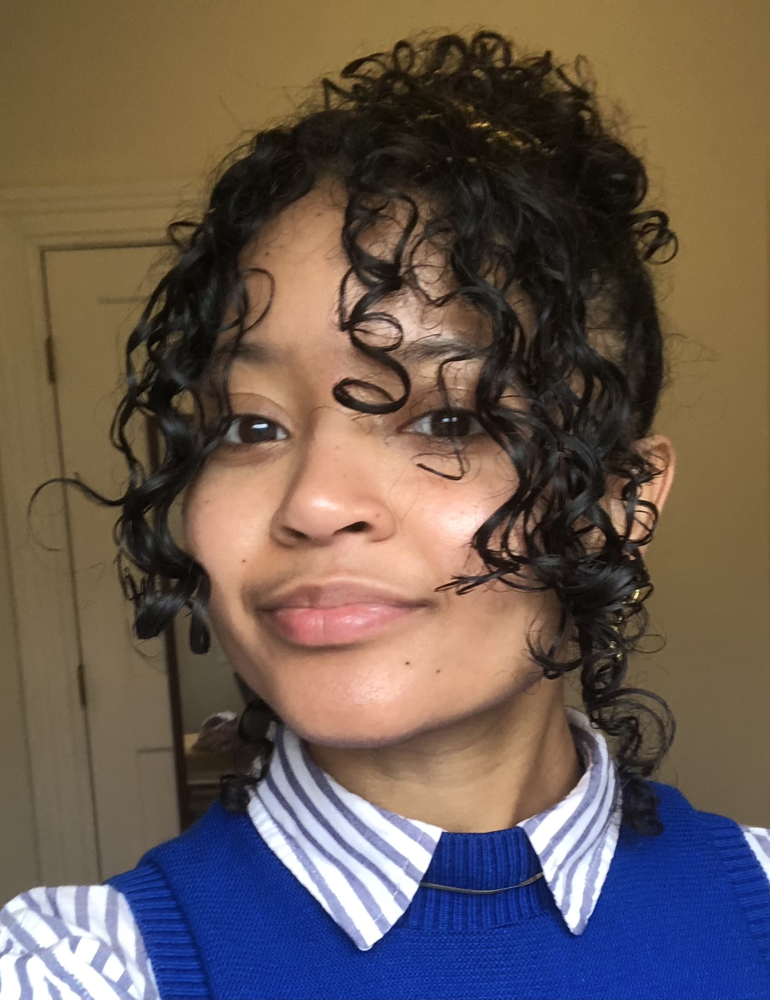

## Welcome to my website!

 

## Profile

I am a Master's student in Environmental Health Data Science at Columbia University, with interdisciplinary interests spanning epidemiology, anthropology, environmental health, and planetary health. As a Jamaican American, I am particularly invested in research addressing health inequities and infectious diseases disproportionately affecting the Caribbean, Latin America, and other marginalized communities, particularly in low- and middle-income countries.

My research interests center on the ecological, climatic, biological, sociocultural, historical, legal, and spatial dimensions of health and disease, particularly vector-borne, zoonotic, neglected, and respiratory infectious diseases. More broadly, I am interested in climate and environmental epidemiology, human–environment interactions, and the intersections of public health with agriculture, food systems, water and sanitation, natural disasters, displacement, and mental health.

Outside of work, I love watching movies, going on hikes, karaoke, learning how to make chocolate, and going to plays, musicals, or other cultural events.

To learn more about my academic and professional experience, go [here](resume.html).